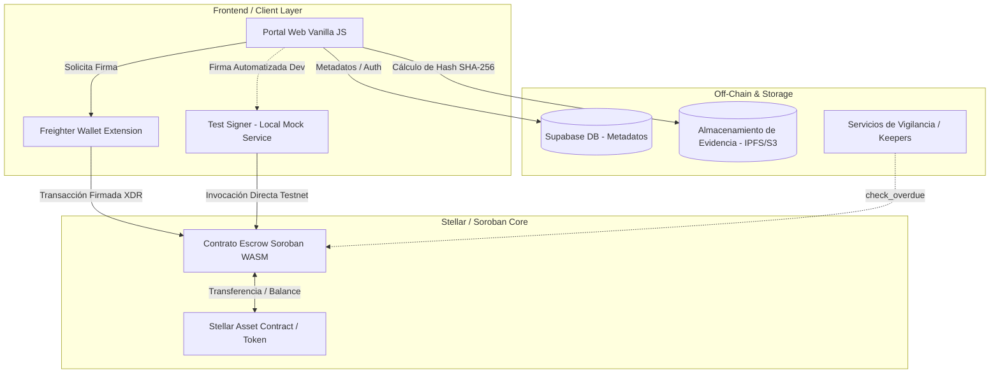
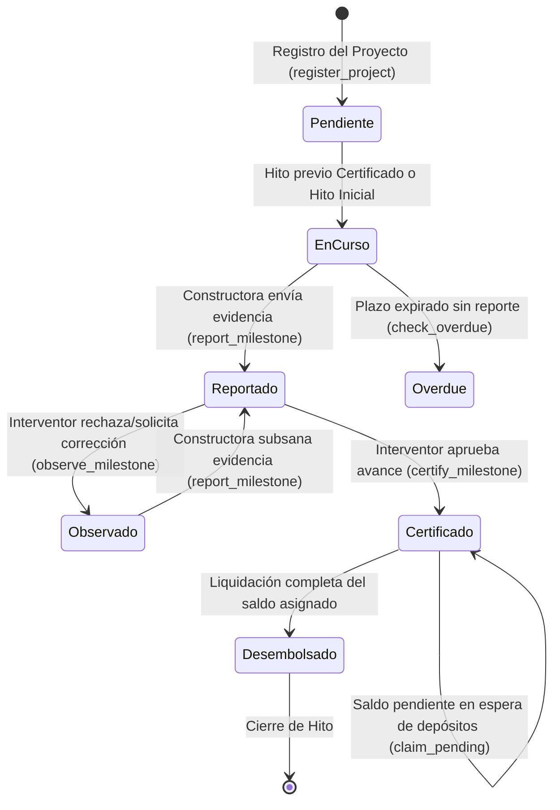

<div align="center">

# 🏗️ INN-LOCK: Protocolo de Escrow Descentralizado
### Custodia Multifirma y Liberación Condicionada de Fondos sobre la Red Stellar

[](https://stellar.org/soroban)
[](https://stellar.expert/explorer/testnet/contract/CBS57WMMUYBWCLFGEKOZYWPRAHHBFP432AJ57P5HFWK6DD7GRI5WJOBT)
[](https://supabase.com)
[](https://viviendastellar.github.io/Proyecto_Vivienda_Stellar/)

<p align="center">
  <b>Garantizando que las cuotas iniciales en preventa inmobiliaria solo se liberen contra avance de obra certificado.</b>
</p>

</div>

---

## 1. Resumen Ejecutivo y Modelo de Negocio

En el modelo tradicional de compra de vivienda sobre planos, los compradores depositan sus cuotas iniciales con una profunda asimetría de información: los recursos suelen concentrarse en cuentas de tesorería de constructoras o fiducias con verificaciones desalineadas con el avance físico real. Ante retrasos o insolvencia, las familias enfrentan pérdidas patrimoniales y litigios que tardan años.

**INN-LOCK** introduce un protocolo de custodia condicionada (*Conditional Escrow*) desplegado en **Soroban (Stellar)**, desacoplando la custodia del capital y subordinando cada desembolso a un consenso verificable de tres actores independientes:

1. **Constructora:** Acredita el cumplimiento técnico mediante reportes periódicos y pruebas de auditoría no repudiables (hashing SHA-256 de evidencia fotográfica y documental).
2. **Interventoría Técnica Independiente:** Inspecciona física y normativamente el hito, certificando o requiriendo subsanaciones con su firma criptográfica.
3. **Administrador Fiduciario:** Administra la incorporación de fondos al depósito en garantía, valida el cumplimiento legal y mitiga contingencias mediante controles de congelamiento preventivo.
4. **Comprador / Beneficiario:** Consulta en tiempo real y sin intermediarios la trazabilidad de sus aportes, la retención en bóveda y el soporte probatorio que habilitó cada desembolso.

---

## 2. Arquitectura de la Solución

El sistema opera bajo una arquitectura desacoplada en tres capas, garantizando que el contrato inteligente sea la **única fuente de verdad (*Single Source of Truth*)** sobre los estados y la custodia de capital.



### Principios Arquitectónicos
* **Custodia no custodial en el cliente:** La aplicación cliente jamás manipula, transmite ni almacena claves privadas. Toda transacción es autenticada directamente por la billetera del usuario (Freighter) o mediante el entorno de pruebas local aislado (`tools/test-signer`).
* **Inmutabilidad y verificación criptográfica:** Las fotos e informes técnicos no se almacenan directamente on-chain por eficiencia de costos (gas); en su lugar, se fija su huella criptográfica (`BytesN<32>`), garantizando integridad forense sin alteraciones.
* **Trazabilidad contable exacta:** La distribución de fondos por hito utiliza aritmética telescópica sobre puntos base (`basis points - bps`), eliminando márgenes de error por redondeo decimal.

---

## 3. Máquina de Estados del Hito (Milestone Lifecycle)

Cada proyecto se descompone en un cronograma de entre 6 y 60 hitos. Cada hito transita por un ciclo de vida estrictamente auditado por el contrato:



---

## 4. Matriz de Roles y Control de Acceso (RBAC & Multi-Auth)

El contrato implementa el mecanismo de autenticación granular de Soroban (`Address::require_auth`), asegurando que solo las identidades debidamente autorizadas ejecuten transacciones críticas:

| Operación | Constructora (`constructora`) | Interventoría (`interventor`) | Fiduciaria / Admin (`administrador`) | Público / Red (`Cualquiera`) |
|:---|:---:|:---:|:---:|:---:|
| `register_project` | **Requerido** | **Requerido** | **Requerido** | ❌ |
| `deposit` | ❌ | ❌ | **Requerido** | ❌ |
| `report_milestone` | **Requerido** | ❌ | ❌ | ❌ |
| `observe_milestone` | ❌ | **Requerido** | ❌ | ❌ |
| `certify_milestone` | ❌ | **Requerido** | ❌ | ❌ |
| `claim_pending` | **Requerido** | ❌ | ❌ | ❌ |
| `request_schedule_change` | **Requerido** | ❌ | ❌ | ❌ |
| `resolve_schedule_change` | ❌ | **Requerido** | ❌ | ❌ |
| `freeze` / `unfreeze` | ❌ | ❌ | **Requerido** | ❌ |
| `set_compliance` | ❌ | ❌ | **Requerido** | ❌ |
| `check_overdue` | ❌ | ❌ | ❌ | **Permitido** |
| Métodos de consulta (`get_*`) | Consulta | Consulta | Consulta | **Lectura Pública** |

> **Nota de Gobernanza:** El rol `comprador` no participa como firmante on-chain en las transacciones operativas de obra para evitar cuellos de botella de disponibilidad y sincronización. La fiduciaria actúa como representante institucional confirmando el ingreso de fondos vía `deposit`, mientras que el comprador ejerce auditoría abierta mediante las funciones de consulta `get_*`.

---

## 5. Especificación de la Interfaz del Contrato (API Reference)

### 5.1 Gestión de Proyecto y Fondos

#### `register_project`
Inicializa el proyecto, asigna los participantes y sella el cronograma original.
```rust
pub fn register_project(
    env: Env,
    project_id: BytesN<16>,
    constructora: Address,
    interventor: Address,
    administrador: Address,
    token: Address,
    presupuesto_total: i128,
    hash_cronograma: BytesN<32>,
    hitos: Vec<MilestoneInput>,
) -> Result<(), Error>
```
* **Firmantes requeridos:** `constructora`, `interventor`, `administrador` (Autenticación simultánea 3-de-3).
* **Validaciones / Errores:**
  * `Error::YaRegistrado`: El `project_id` ya existe en almacenamiento persistente.
  * `Error::PresupuestoInvalido`: `presupuesto_total <= 0`.
  * `Error::CantidadHitosInvalida`: Cantidad de hitos fuera del rango normativo [6, 60].
  * `Error::HitoExcedeTope`: Un hito concentra más porcentaje del tope permitido (`max(15%, 200% / cantidad_hitos)`).
  * `Error::FechaPasada`: La fecha límite del primer hito es menor o igual al timestamp actual del ledger.
  * `Error::FechasNoCrecientes`: Las fechas de entrega no son estrictamente crecientes.
  * `Error::SumaPorcentajesInvalida`: La suma de `percentage_bps` difiere de 10.000 bps (100.00%).

---

#### `deposit`
Registra el ingreso de fondos retenidos asociados a un comprador y unidad específica.
```rust
pub fn deposit(
    env: Env,
    project_id: BytesN<16>,
    buyer_id: BytesN<16>,
    monto: i128,
) -> Result<(), Error>
```
* **Firmantes requeridos:** `administrador`.
* **Comportamiento:** Transfiere tokens del balance del administrador hacia la cuenta del contrato mediante el Stellar Asset Contract (SAC). Incrementa el balance disponible del escrow y el acumulado de aportes del comprador. Opera incluso si el proyecto se encuentra congelado (la entrada de capital no compromete la seguridad).

---

### 5.2 Ciclo Operativo de Obra y Certificación

#### `report_milestone`
Radica la entrega técnica de una etapa de obra con respaldo probatorio inmutable.
```rust
pub fn report_milestone(
    env: Env,
    project_id: BytesN<16>,
    index: u32,
    evidence_hash: BytesN<32>,
    photo_count: u32,
) -> Result<(), Error>
```
* **Firmantes requeridos:** `constructora`.
* **Validaciones / Errores:**
  * `Error::HitoNoEnCurso`: El hito no está en estado `EnCurso` ni `Observado`.
  * `Error::FotosInsuficientes`: Requiere un mínimo de 3 registros fotográficos (`photo_count >= 3`).
  * `Error::EvidenciaVacia`: `evidence_hash` inválido o nulo.
* **Evento emitido:** `MilestoneReported { project_id, index, evidence_hash }`.

---

#### `observe_milestone`
Emite un requerimiento técnico o rechazo sobre el reporte de avance presentado.
```rust
pub fn observe_milestone(
    env: Env,
    project_id: BytesN<16>,
    index: u32,
    reason_hash: BytesN<32>,
) -> Result<(), Error>
```
* **Firmantes requeridos:** `interventor`.
* **Efecto de estado:** Cambia el estado del hito a `Observado`, impidiendo desembolsos y habilitando a la constructora a subsanar el reporte.
* **Evento emitido:** `MilestoneObserved { project_id, index, reason_hash }`.

---

#### `certify_milestone`
Certifica el cumplimiento de obra y ejecuta la liquidación financiera correspondiente.
```rust
pub fn certify_milestone(
    env: Env,
    project_id: BytesN<16>,
    index: u32,
    evidence_hash: BytesN<32>,
) -> Result<(), Error>
```
* **Firmantes requeridos:** `interventor`.
* **Validaciones / Errores:**
  * `Error::ProyectoCongelado`: Operaciones de salida bloqueadas por el administrador.
  * `Error::DocumentosVencidos`: La constructora incumple políticas legales o parafiscales (`compliance == false`).
  * `Error::HitoNoReportado`: El hito no posee un reporte en revisión.
  * `Error::HashNoCoincide`: La evidencia certificada no coincide exactamente con el hash radicado por la constructora.
* **Liquidación financiera:**
  * Calcula el monto objetivo del hito mediante distribución proporcional.
  * Desembolsa inmediatamente hasta el máximo de fondos disponibles en custodia.
  * Si los depósitos no cubren el 100%, el saldo remanente queda registrado como pasivo exigible (`pending`).
  * Habilita inmediatamente la ejecución del hito siguiente (`index + 1`).
* **Eventos emitidos:** `MilestoneCertified`, `Disbursed` y, si corresponde, `ProjectFinished`.

---

#### `claim_pending`
Liquida saldos remanentes de hitos previamente certificados cuando ingresan nuevos depósitos.
```rust
pub fn claim_pending(
    env: Env,
    project_id: BytesN<16>,
    index: u32,
) -> Result<(), Error>
```
* **Firmantes requeridos:** `constructora`.
* **Precondición:** El hito debe tener un balance pendiente (`pending > 0`) y el contrato debe disponer de liquidez suficiente en custodia.

---

### 5.3 Control de Cumplimiento y Contingencias

#### `freeze` / `unfreeze`
Mecanismo de salvaguarda fiduciaria ante disputas jurídicas o contingencias operativas.
```rust
pub fn freeze(env: Env, project_id: BytesN<16>, reason_hash: BytesN<32>) -> Result<(), Error>
pub fn unfreeze(env: Env, project_id: BytesN<16>) -> Result<(), Error>
```
* **Firmantes requeridos:** `administrador`.
* **Alcance:** Bloquea de inmediato las transferencias de salida (`certify_milestone` y `claim_pending`), manteniendo habilitadas las funciones de recepción (`deposit`) e inspección (`report_milestone`, `observe_milestone`).

---

#### `set_compliance`
Control de elegibilidad legal y parafiscal de la constructora.
```rust
pub fn set_compliance(env: Env, project_id: BytesN<16>, status: bool) -> Result<(), Error>
```
* **Firmantes requeridos:** `administrador`.
* **Efecto:** Al establecerse en `false`, suspende preventivamente cualquier liquidación financiera hacia la constructora.

---

#### `check_overdue`
Alerta descentralizada de vencimiento de plazos de entrega.
```rust
pub fn check_overdue(env: Env, project_id: BytesN<16>, index: u32) -> Result<(), Error>
```
* **Firmantes requeridos:** Ninguno (Invocación pública).
* **Propósito:** Puede ser ejecutado por cualquier observador o servicio automatizado (*Keeper*) al superar la fecha límite pactada, dejando un registro inmutable del retraso sin alterar la custodia de fondos.

---

### 5.4 Gestión Controlada de Cronograma

#### `request_schedule_change` & `resolve_schedule_change`
Gobierna modificaciones justificadas de fechas y reponderación de porcentajes sobre hitos futuros.
* **Proposición (`request_schedule_change`):** Firmada por la `constructora`. Requiere justificación criptográfica (`reason_hash`), prohíbe modificar hitos ya iniciados y garantiza la conservación estricta de la suma de porcentajes (invariante del 100%).
* **Resolución (`resolve_schedule_change`):** Firmada por el `interventor`. Si se aprueba, actualiza el cronograma on-chain; si se rechaza, archiva la solicitud.

---

## 6. Manejo de Almacenamiento y Ciclo de Vida (State TTL)

En la red Soroban, las entradas de almacenamiento persistente (`persistent()`) requieren renovación periódica de su tiempo de vida (*Time-To-Live / TTL*) para evitar archivado:

```rust
const DIA_EN_LEDGERS: u32 = 17280;          // ~5 segundos por ledger
const TTL_UMBRAL_LEDGERS: u32 = 30 * DIA_EN_LEDGERS;   // Umbral de 30 días
const TTL_EXTENDER_LEDGERS: u32 = 120 * DIA_EN_LEDGERS; // Extensión a 120 días
```

* **Política de Auto-Renovación:** Cada operación de lectura o escritura sobre el estado (`leer`, `guardar`) ejecuta automáticamente `extend_ttl`, garantizando que ningún registro activo quede desatendido mientras el proyecto esté en operación.
* **Margen de Seguridad:** El protocolo 29 de Stellar establece un límite máximo de almacenamiento en Testnet de 180 días (`3.110.400` ledgers); INN-LOCK renueva hasta 120 días, manteniendo un margen prudente por debajo del techo de la red.

---

## 7. Registro de Despliegue en Stellar Testnet

El contrato se encuentra compilado en WebAssembly optimizado y desplegado en la red de pruebas oficial de Stellar:

| Parámetro | Valor Verificado |
|---|---|
| **Red** | `Stellar Testnet` |
| **Network Passphrase** | `Test SDF Network ; September 2015` |
| **RPC Endpoint** | `https://soroban-testnet.stellar.org` |
| **Escrow Contract ID** | `CBS57WMMUYBWCLFGEKOZYWPRAHHBFP432AJ57P5HFWK6DD7GRI5WJOBT` |
| **Stellar Asset Contract (SAC)** | `CDLZFC3SYJYDZT7K67VZ75HPJVIEUVNIXF47ZG2FB2RMQQVU2HHGCYSC` (Native Asset) |
| **WASM Hash** | `0e4c459b058e8f5359decb6b65cac210c6aee589eefc337f0c6068a3eba5a957` |
| **Cuenta Administrador (Deployer)** | `GBP3BRO5XE3EG7YVSE74OQVFCK4XCOOCWCGXHTFEBTBLZCQ576EVMI7M` |
| **Explorador Stellar Expert** | [Ver contrato en Stellar Expert](https://stellar.expert/explorer/testnet/contract/CBS57WMMUYBWCLFGEKOZYWPRAHHBFP432AJ57P5HFWK6DD7GRI5WJOBT) |

### Identidades de Prueba Preconfiguradas (Testnet)
Para entornos de integración local y pipelines automatizados, se definieron identidades correspondientes a cada actor del protocolo:
* **Constructora (`inn-constructora`):** `GCYQDJ6UO3EHEL4GXLVMGTVTJEOV3OTWDJQPGSFTHPS2BCLRLT4OYRJS`
* **Interventoría (`inn-interventor`):** `GAGEYZHS5LQPGQSK5YNQBCR6RKUJLSPO7ET4K76UJXZJUH6QZZ5PWEIW`
* **Administrador (`inn-admin`):** `GBP3BRO5XE3EG7YVSE74OQVFCK4XCOOCWCGXHTFEBTBLZCQ576EVMI7M`

---

## 8. Guía de Ejecución y Pruebas (DevOps & Testing)

### 8.1 Requisitos de Entorno
* **Rust:** v1.84 o superior con target WebAssembly (`rustup target add wasm32v1-none`).
* **Stellar CLI:** Instalado y configurado en PATH (`stellar --version`).
* **Node.js:** v18.0.0 o superior (compatible con fetch nativo).
* **Python 3:** Para servidor web local.
* **Freighter Wallet:** Extensión configurada en la red `Testnet`.

---

### 8.2 Compilación y Pruebas Unitarias (Rust / Soroban)
El espacio de trabajo de Cargo se ubica en `contracts/escrow`:

```bash
cd contracts/escrow

# 1. Compilación del binario WASM optimizado
stellar contract build

# 2. Ejecución de la suite completa de pruebas unitarias
cargo test
```
La suite unitaria en `contracts/escrow/contracts/escrow/src/test.rs` evalúa exhaustivamente:
* Orquestación de multi-autenticación (`mock_auths`).
* Aritmética de liquidación proporcional y desembolsos parciales.
* Casos límite: desbordamientos aritméticos, congelamiento, vencimientos extemporáneos y variaciones de cronograma.

---

### 8.3 Pruebas de Integración de Punta a Punta (E2E Testnet)
Para validar la interacción real contra la red sin depender de extensiones de navegador:

```bash
# Ejecuta el flujo feliz de 3 firmas y 5 escenarios negativos de seguridad
./e2e-testnet.sh
```

**Casos negativos evaluados en el test E2E:**
1. Intento de firma con cuenta no autorizada.
2. Alteración del cronograma tras la recolección de firmas iniciales.
3. Transacción enviada con firma expirada en el ledger.
4. Intento de duplicación de proyecto ya registrado.
5. Inconsistencia en la sumatoria de porcentajes de hitos.

---

### 8.4 Ejecución del Frontend y Conexión On-Chain

Levantar el servidor local estático:
```bash
cd frontend
python -m http.server 4180
```

Acceso por modos de ejecución:
* **Modo Demostración Local:** `http://localhost:4180/?demo=1`  
  Permite navegar los 4 perfiles con credenciales de prueba predeterminadas (`admin@inn-lock.co`, `constructora@inn-lock.co`, etc.).
* **Modo Demostración On-Chain (Testnet):** `http://localhost:4180/?demo=1&chain=testnet`  
  Integra la interfaz con el contrato real en Testnet. El asistente de registro solicita las 3 firmas criptográficas reales (Constructora → Interventor → Administrador) vía **Freighter** o mediante el servicio local `tools/test-signer`.

---

## 9. Alcance del Piloto y Hoja de Ruta (Roadmap)

### Estado Actual del Piloto (MVP)
- [x] Contrato inteligente Soroban desplegado y verificado en Testnet con cobertura de tests unitarios y de snapshot.
- [x] Flujo multifirma 3-de-3 implementado y probado para el registro inicial del proyecto (`register_project`).
- [x] Orquestación de firma asíncrona mediante preservación de nonces y ventanas de ledger calculadas.
- [x] Suite de automatización E2E sin interfaz gráfica.

### Hoja de Ruta hacia Producción (Mainnet)
1. **Fase 1: Conexión Integral de Funciones Operativas al Frontend:**
   * Vincular interfaces gráficas para `report_milestone`, `certify_milestone` y `claim_pending` con transacciones reales on-chain (actualmente simuladas localmente tras el registro).
2. **Fase 2: Identidades Descentralizadas y Multi-Tenant:**
   * Migración de direcciones públicas compartidas de prueba a billeteras únicas por usuario en base de datos.
3. **Fase 3: Keepers y Orquestación Backend (`services/`):**
   * Puesta en marcha de `services/keeper` para la invocación programada de `check_overdue`.
   * Implementación de `services/verifier` para reconciliación continua de balances entre el ledger de Stellar y la base de datos de auditoría.
4. **Fase 4: Pasarelas Fiat-to-Token:**
   * Integración con proveedores fiduciarios y pasarelas bancarias (ej. PSE / ACH) vinculadas al anclaje del activo tokenizado.
